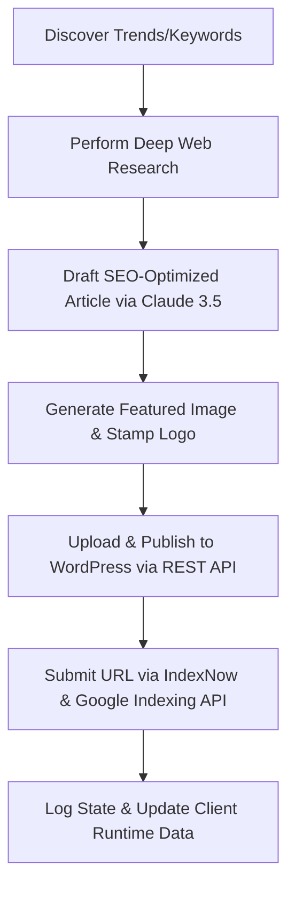

# 🚀 Autonomous SEO Writer & Publisher Agent

[](https://github.com/navigotechsolutions-labs/autonomous-seo-writer/stargazers)
[](LICENSE)
[](https://www.python.org/)
[](https://anthropic.com)

An enterprise-grade, **multi-tenant AI Agent** that automates the entire content marketing lifecycle. It autonomously discovers trending keywords, conducts web research, drafts high-ranking SEO-optimized articles, generates custom branded featured images with logo overlays, publishes to WordPress, and instantly submits URLs for search engine indexing.

One central engine can service multiple clients/tenants simultaneously using isolated configurations.

---

## 🌟 Key Features

* 📈 **Autonomous Trend Discovery**: Auto-detects trending industry keywords and breaking news using Google Trends, sitemaps, and RSS feeds.
* ✍️ **Deep AI Content Generation**: Utilizes Claude 3.5 Sonnet to write high-quality, long-form (1,500+ words) SEO articles with correct schema markup, semantic headings, and custom markdown tables.
* 🎨 **Branded Featured Images**: Automatically generates custom, high-converting blog header images and overlays the tenant's brand logo dynamically.
* 🔌 **WordPress REST API Automation**: Publishes drafts directly, assigns tags/categories, manages slugs, and formats clean HTML.
* ⚡ **Instant Search Indexing**: Submits published posts directly to Google Indexing API and **IndexNow** (Bing, Yandex, Seznam) for near-instant search engine crawling.
* 👥 **Multi-Tenant Architecture**: Scale your agency! Add new clients in minutes using simple configuration files.

---

## 🔄 Workflow Pipeline



---

## 📁 Repository Structure

```
agent/          # Config-driven core engine (ai, trends, research, writer, image gen, publisher, indexer)
clients/        # Isolated client workspace containing config.yaml and brand assets/logo.png
  _template/    # Boilerplate template for onboarding new tenants
  navigo/       # Default tenant setup (NaviGo Tech Solutions)
data/           # Runtime history per client (used keywords, drafts, and publication logs)
cli.py          # Interactive developer Command Line Interface
```

---

## 🛠️ Setup & Installation

1. Clone the repository and navigate to the folder:
   ```bash
   git clone https://github.com/navigotechsolutions-labs/autonomous-seo-writer.git
   cd autonomous-seo-writer
   ```

2. Create and activate a Python virtual environment:
   ```bash
   python -m venv venv
   # On Windows:
   venv\Scripts\activate
   # On macOS/Linux:
   source venv/bin/activate
   ```

3. Install the dependencies:
   ```bash
   pip install -r requirements.txt
   ```

4. Configure your environment variables:
   ```bash
   cp .env.example .env
   # Open .env and fill in your API tokens (Anthropic, DeepSeek, Gemini, Pexels, and WordPress Credentials)
   ```

---

## 🚀 Usage Guide

### 1. Manage Tenants
```bash
# List all onboarded clients and their enabled status
python cli.py list

# Onboard a new client (scaffolds clients/acme/ from _template)
python cli.py add-client acme
```

### 2. Validate Setup
```bash
# Check WordPress credentials, IndexNow access, sitemaps, and brand logos
python cli.py validate navigo
```

### 3. Generate & Publish Articles
```bash
# Generate a draft to data/navigo/drafts/ without publishing (Dry Run)
python cli.py run navigo --dry-run

# Generate, attach logo-overlay image, publish to WordPress, and trigger search indexing
python cli.py run navigo

# Service every enabled client in sequence (perfect for cron jobs)
python cli.py run-all
```

---

## ⏱️ Scheduling Automation

To automate posting, schedule the runner script as a cron job (Linux/macOS) or Windows Task Scheduler:

```bash
# Run outreach and blog automation every 6 hours
0 */6 * * * /path/to/venv/bin/python /path/to/autonomous-seo-writer/cli.py run-all
```

---

## 📄 License

Distributed under the **MIT License**. See [LICENSE](LICENSE) for details.
