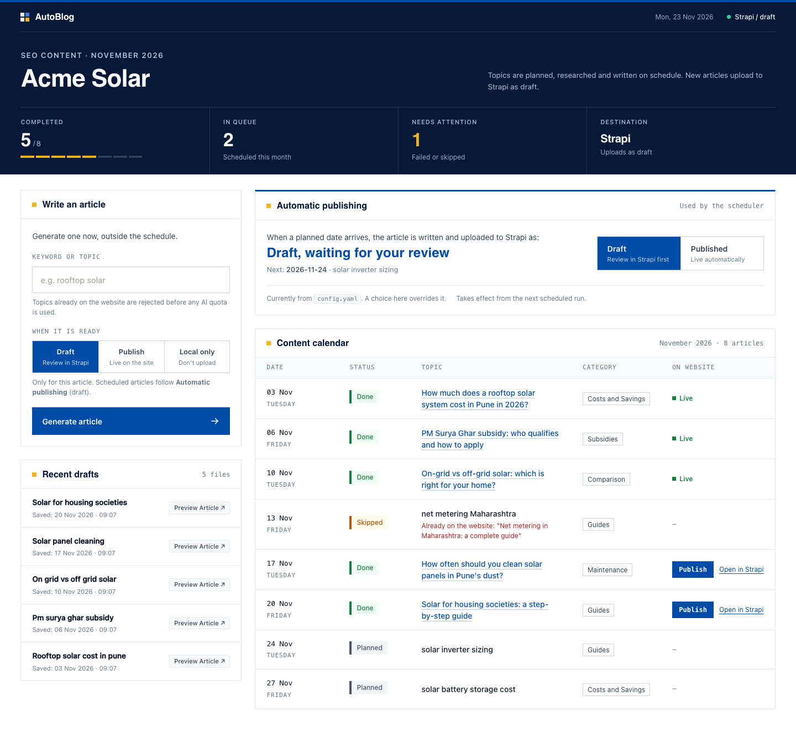
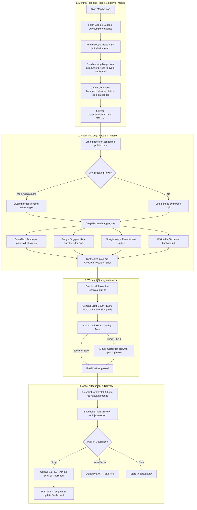

# AutoBlog Engine

**Your SEO blog on autopilot: researched, written and published for you.**

AutoBlog Engine plans, writes and uploads blog articles for your business by itself, on the days you
choose, using free services only. A web dashboard shows the monthly plan and lets you publish drafts
with one click.



## How it works

One scheduled job runs **once a day** (at `SCHEDULE_TIME`). Each run does whatever is due:

```
daily run
 ├─ 1. No plan for this month yet?  → plan the month's topics and dates
 ├─ 2. Uploads that failed before?   → retry them
 └─ 3. Articles dated today or earlier? → write and upload them (otherwise: "Nothing due today")
```

There are no separate jobs and no per-article times. An article goes out on the daily run of its date.
If the machine was off that day, the next run catches up.

### 1. Planning (first run of each month)

| Step | Uses |
|---|---|
| Find what your customers search for on Google | Google suggestions (no key) |
| Gather recent headlines in your field | Google News (no key) |
| Read every post already on your site, plus every topic written before | `STRAPI_API_TOKEN` (or WordPress) |
| Pick the month's topics, angles, categories and dates, never repeating an existing one | `GEMINI_API_KEY` |

The plan is saved to `data/<client>/plans/YYYY-MM.json`. Duplicates are filtered in code too, in case
the AI ignores the "already published" list.

### 2. Writing (each publish day)

| Step | Uses |
|---|---|
| News check: if an important story deserves the slot, swap the planned topic for it (at most `max_news_per_month`, default 1) | Google News (no key) + `GEMINI_API_KEY` |
| Final check that the topic is not already on the site, before any AI quota is spent | `STRAPI_API_TOKEN` (or WordPress) |
| Research: real questions, research papers, news, background | Google, Wikipedia (no key), OpenAlex (`OPENALEX_API_KEY`, free) |
| Write the article | `GEMINI_API_KEY` |
| Check it: SEO rules plus an AI editor score; rewrite up to 3 times if needed | `GEMINI_API_KEY` |
| Add a cover photo and 2 images | `UNSPLASH_ACCESS_KEY` |
| Upload as a draft or published, then ping search engines when it goes live | `STRAPI_API_TOKEN` (or WordPress) |

If writing fails (for example Gemini is busy), the article is retried on the next daily runs, up to
3 attempts. One article uses about 4 to 10 Gemini requests.

Only Gemini and Unsplash are required. Without an OpenAlex key, articles skip research papers.
Without a CMS, articles are just saved as files.

## Technology Stack & Search Mechanisms

Here is every technology, search engine, and API used by the engine under the hood:

| Task / Purpose | Technology / Service Used | How It Works Under the Hood | Needs Key? |
|---|---|---|:---:|
| **Real User Questions & Keywords** | **Google Suggest API** (`suggestqueries.google.com`) | Queries Google autocomplete with seed keywords, alphabet letters (a–z), and prefixes (*what, how, why, vs*) to extract real user search intent and FAQ questions. | ❌ Free HTTP |
| **Industry News & Trends** | **Google News RSS** (`news.google.com/rss`) | Scrapes Google News RSS feeds filtered by keyword, client country (`gl`), and date window (`when:1y` or `7d`). | ❌ Free HTTP |
| **Scientific & Engineering Papers** | **OpenAlex API** (`api.openalex.org/works`) | Searches global peer-reviewed academic journals for published research, abstracts, and engineering standards. | 🟢 Free Key (`OPENALEX_API_KEY`) |
| **Technical Background & Definitions** | **Wikipedia REST API** (`en.wikipedia.org/w/api.php`) | Performs semantic query search and extracts introductory definitions and material physics. | ❌ Free HTTP |
| **Article Writing & AI Reasoning** | **Google Gemini API** (`google-genai` SDK) | Multi-pass LLM generation: system prompt, topic planning, long-form drafting (1,200+ words), and 3-stage iterative self-review. | 🟢 Free Key (`GEMINI_API_KEY`) |
| **Royalty-Free Photos & Media** | **Unsplash API** (`api.unsplash.com`) | Searches relevant high-res commercial photography, selects cover + 2 inline body photos with accessible alt tags. | 🟢 Free Key (`UNSPLASH_ACCESS_KEY`) |
| **CMS Publishing / Storage** | **Strapi REST API** or **WordPress REST API** | Uploads formatted HTML/Markdown, attaches media assets, and sets status (`draft` or `published`). | 🟢 Token (`STRAPI_API_TOKEN`) |
| **Search Engine Indexing Ping** | **Google & Bing Ping Endpoints** | Notifies search engine crawlers automatically when a post is marked published. | ❌ Automatic |
| **Web Dashboard** | **Python `http.server` + Custom CSS** | Lightweight local dashboard on port `8000` (or `8085`) to view the calendar, recent drafts, and manual generation. | ❌ Built-in Python |
| **Deployment & Scheduler** | **Docker & Docker Compose** (`cli.py daemon`) | Runs the background scheduler container and web dashboard container isolated on your VPS. | ❌ Docker |

## Full Operational Flow



## Getting started

You need [Docker](https://docs.docker.com/get-docker/) and two free keys:
[Gemini](https://aistudio.google.com/apikey) and [Unsplash](https://unsplash.com/developers).

**1. Download it**

```bash
git clone https://github.com/navigotechsolutions-labs/autonomous-seo-writer.git
cd autonomous-seo-writer
```

**2. Add your keys**

```bash
cp .env.example .env
```

Open `.env` and paste your `GEMINI_API_KEY` and `UNSPLASH_ACCESS_KEY`. Add `STRAPI_API_TOKEN` if you
publish to Strapi (it needs find, findOne, create and update on the blog collection, plus Upload).

**3. Describe your business**

```bash
cp -r clients/_template clients/mybusiness
```

Open `clients/mybusiness/config.yaml` and fill it in: your company, products, customers, website and
CMS details. Every line is explained in the file. When you're done, set `enabled: true`.

**4. Check and start it**

```bash
docker compose run --rm writer python cli.py validate mybusiness   # checks keys, CMS token, existing posts
docker compose up -d --build
```

That's it. It now runs every day. Check it with `docker compose logs -f writer`.

## Where articles go

`publish_to` in the config (or `PUBLISH_TO` in `.env`) picks the destination:

- `strapi`: uploaded to your Strapi website
- `wordpress`: posted to your WordPress website
- `files`: saved only, not uploaded (good for testing)

Left empty, it uses whichever CMS is configured, or `files` if none is.
Every article is also saved in `data/<client>/drafts/` as `.html` (preview), `.json` and `.jpg`.

### Draft or published

Uploads land as **drafts** (you review them first) or **published** (live at once). Where this is set,
highest priority first:

1. The **Automatic publishing** switch on the dashboard (saved in `data/<client>/settings.json`)
2. `PUBLISH_STATUS` in `.env`
3. `strapi.status` / `wordpress.status` in `config.yaml`

A change takes effect from the next scheduled run. Choosing the `.env` / config value again on the
dashboard removes the override.

## Dashboard

The dashboard shows one business (`CLIENT` in `.env`). The screenshot above uses example data.

**With Docker:**

```bash
docker compose --profile web up -d
```

Open http://127.0.0.1:8000

**Without Docker:**

```bash
make start            # or: npm start  (http://127.0.0.1:8085, auto-reloads on code changes)
CLIENT=mybusiness PORT=9000 make start
```

On the dashboard you can:

- **See the content calendar**: every planned article with its date, status (planned, done, skipped,
  failed, with the error), category and whether it's on the website.
- **Publish a draft**: click **Publish** next to an uploaded draft, or **Open in Strapi/WordPress**
  to edit it first. Posts already published in the CMS admin show as **Live**.
- **Switch automatic publishing** between Draft and Published for the scheduler.
- **Write an article now**, outside the schedule, and choose Draft, Published or Local only.
  Topics already on the website are rejected before any AI quota is used.
- **Read recent drafts** as they will appear.

The dashboard has no login and is only reachable from your own machine. Don't expose it to the internet.

## Settings (`.env`)

| Setting | Example | Meaning |
|---|---|---|
| `GEMINI_API_KEY` | | Required. Writing and planning |
| `UNSPLASH_ACCESS_KEY` | | Required. Images |
| `OPENALEX_API_KEY` | | Optional. Research papers |
| `STRAPI_API_TOKEN` | | Needed for Strapi |
| `WP_USERNAME`, `WP_APP_PASSWORD` | | Needed for WordPress |
| `PUBLISH_TO` | `strapi` | `strapi`, `wordpress` or `files`. Overrides `publish_to` for all businesses |
| `PUBLISH_STATUS` | `draft` | `draft` or `published`. Overrides the config (the dashboard overrides this) |
| `POSTS_PER_MONTH` | `8` | How many articles a month |
| `PUBLISH_DAYS` | `tue,fri` | Which weekdays to post on |
| `SCHEDULE_TIME` | `09:07` | What time the daily run happens |
| `SCHEDULE_TZ` | `Asia/Kolkata` | Timezone of `SCHEDULE_TIME` (servers often run on UTC) |
| `RUN_ON_START` | `1` | Docker: also run once when the container starts |
| `CLIENT` | `mybusiness` | Which business the dashboard shows |
| `GEMINI_MODELS` | | Advanced: Gemini models to try, in order |

After changing `.env` or the config, run `docker compose up -d --force-recreate`.

## Commands

With Docker, prefix these with `docker compose run --rm writer`. Without Docker, use
`./venv/bin/python` instead of `python`.

```bash
python cli.py validate mybusiness        # check keys, CMS token and existing posts
python cli.py plan mybusiness            # show this month's plan (--new to re-plan)
python cli.py run mybusiness             # write one article now (--keyword "..." for a topic, --dry-run)
python cli.py run-next mybusiness        # run the full daily job now, with the next planned article moved to today
python cli.py auto                       # the daily job itself, for every enabled business
python cli.py push mybusiness <draft>    # upload a saved article (skipped if already on the site)
python cli.py serve mybusiness           # dashboard (--port, --reload)
python cli.py list                       # list businesses
python cli.py add-client mybusiness      # create a new business from the template
```

```bash
docker compose logs -f writer            # see what it's doing
docker compose down                      # stop it
git pull && docker compose up -d --build # update to the latest version
```

## Without Docker

```bash
python3 -m venv venv && ./venv/bin/pip install -r requirements.txt
./venv/bin/python cli.py validate mybusiness
./venv/bin/python cli.py schedule on     # run daily: launchd on macOS, cron on Linux (off / status too)
make start                               # dashboard
make test                                # run the tests
```

`schedule on` registers the same single daily job (`cli.py auto`) at `SCHEDULE_TIME` in `SCHEDULE_TZ`.
In Docker, `cli.py daemon` does this instead, so no cron is needed.

## Good to know

- It never writes the same topic twice, and never uploads something already on your site.
- The free Gemini plan is enough for about 2 articles a week. If it's busy, the article waits for the next day.
- Only one daily run happens at a time; a second one started meanwhile exits straight away.
- Your keys stay in `.env`, which is never uploaded to GitHub.

## License

MIT. Free to use and change. See [LICENSE](LICENSE).
